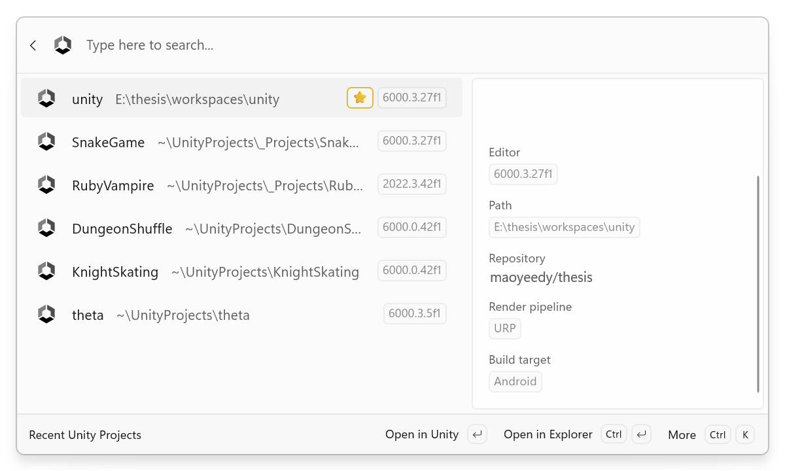

# Command Palette (CmdPal) Unity Extension

## Overview
Command Palette extension for opening Unity Hub recent projects.[^1]



## Installation

### Requirements
- [PowerToys](https://learn.microsoft.com/en-us/windows/powertoys/) with Command Palette enabled
- Unity Hub 3 or 4 with recent projects history

> Unity Hub not required in background - extension launches editor directly.

### Recommended: Microsoft Store

Get it from the [Microsoft Store](https://apps.microsoft.com/store/detail/app/9NVSJZ72LTZ3).

### Via GitHub Releases

1. Remove any existing package:
   ```powershell
   Get-AppxPackage *CommandPalette-Unity* | Remove-AppxPackage
   ```
2. Download the `.msixbundle` from [Releases](https://github.com/maoyeedy/CommandPaletteUnity/releases) and install.

## Contributing and development

See [`CONTRIBUTING.md`](CONTRIBUTING.md) and [`docs/DEVELOPMENT.md`](docs/DEVELOPMENT.md).

[^1]: Not affiliated with Unity Technologies. This extension uses local Unity Hub data only; its one write is removing a project from Hub's list when you ask.
